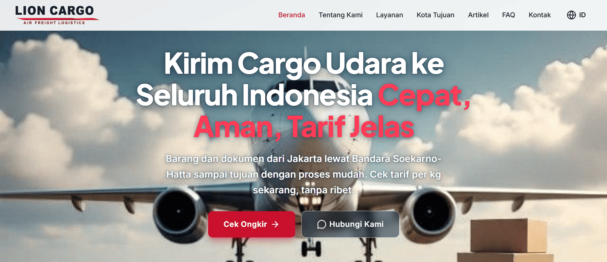
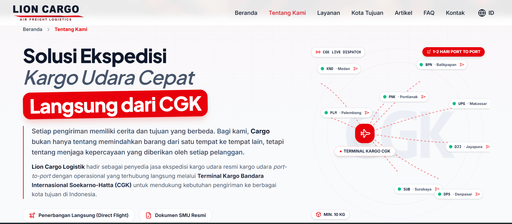
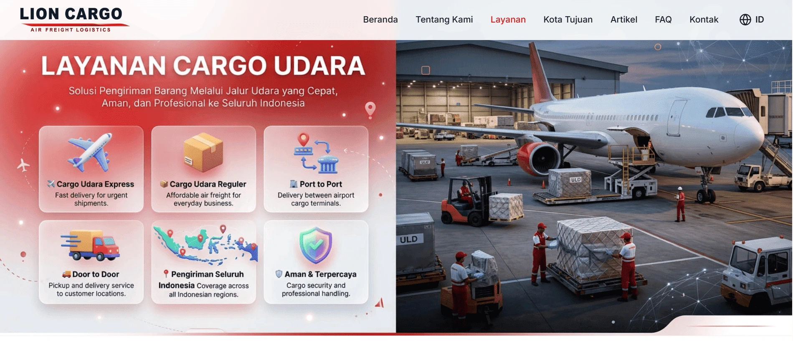
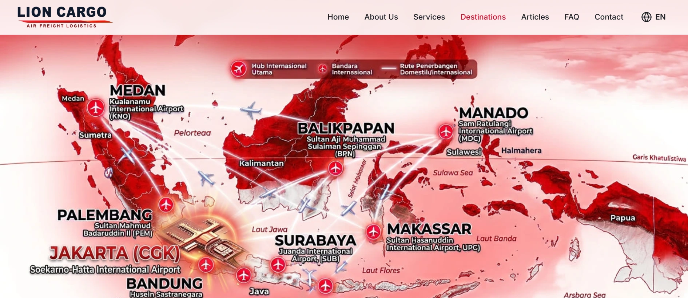

# 🚚 Lion Cargo Logistik

A modern company profile website for air cargo services in Indonesia.

🌐 **Live Website**  
https://lioncargologistik.com


## 📌 Overview

Lion Cargo Logistik is a professional cargo service website built to provide information about air freight services, destination coverage, and shipping solutions.

This project focuses on developing a modern, fast, and SEO-friendly website with a scalable architecture to support business growth and improve customer accessibility.

The website implements responsive UI, internationalization support, structured SEO optimization, and production-ready deployment workflow.


## ✨ Features

### 🌐 Company Profile

- Professional company profile website
- Company information pages
- Cargo service information
- Destination city pages
- Contact and customer inquiry integration


### 🚚 Cargo Services Information

- Air cargo service details
- Regular, Express, and Same Day service information
- Shipping requirements and policies
- Transparent service information


### 🌍 Internationalization (i18n)

- Indonesian language support
- English language support
- SEO-friendly localized pages


### 🔍 SEO Optimization

- Dynamic metadata
- Structured data (Schema.org)
- Open Graph optimization
- Sitemap generation
- Robots configuration
- Search engine friendly URL structure


### 📝 Article System

- Article listing page
- Article detail page
- SEO-focused content structure


### 📱 Responsive Design

- Mobile-friendly interface
- Optimized layout for desktop, tablet, and mobile devices


## 🛠 Tech Stack

### Frontend

- Next.js
- React
- TypeScript
- Tailwind CSS
- Framer Motion
- Lucide Icons


### Backend & Database

- Supabase
- PostgreSQL


### Deployment & Infrastructure

- Domain: lioncargologistik.com
- Hosting Platform: Cloudflare Workers
- Framework Adapter: OpenNext
- Version Control: GitHub


## 📂 Project Architecture

The project uses a modular structure designed for scalability and maintainability.

```text
src
├── app          # Application routes and pages
├── components   # Reusable UI components
├── config       # Website configuration
├── features     # Feature-based modules
├── lib          # Shared utilities
├── services     # External services
├── types        # Type definitions
└── utils        # Helper functions
```


## 📸 Screenshots

### Homepage




### About Us




### Services




### Destination Cities




## 🚀 Getting Started

### Clone Repository

```bash
git clone https://github.com/Bahrull-17/lion-cargo-logistik.git
```

### Install Dependencies

```bash
npm install
```

### Run Development Server

```bash
npm run dev
```

Open in browser:

```
http://localhost:3000
```


## 📦 Production Build

Create production build:

```bash
npm run build
```

Run production server:

```bash
npm start
```


## 🎯 Project Goals

This project was built to implement modern software development practices including:

- Full-stack web development workflow
- SEO implementation strategy
- Internationalized website architecture
- Responsive web design
- Production deployment workflow
- Scalable frontend architecture


## 👨‍💻 Developer

**Bahrul Ulum**

Full Stack Developer


🌐 Portfolio  
https://bahrull-17.github.io/Portfolio/


💼 LinkedIn  
https://www.linkedin.com/in/bahrul-ulum17
