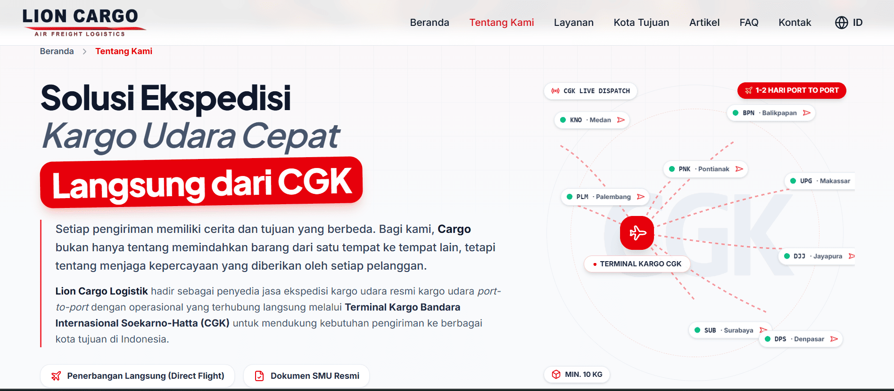
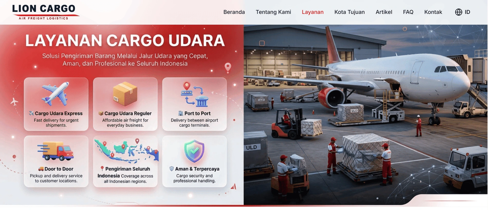
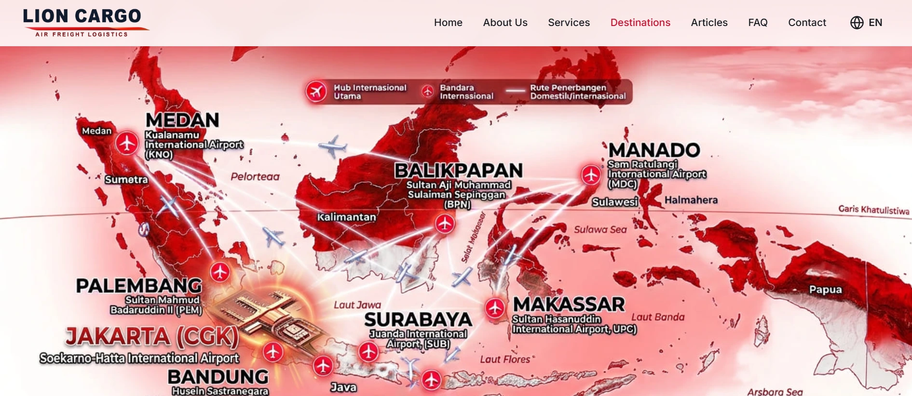

# 🚚 Lion Cargo Logistik

A bilingual (Indonesian / English) company profile website for an air cargo service in Indonesia, with a shipping rate calculator and a content admin panel.

🌐 **Live website:** https://lioncargologistik.com

> The destination and rate pages read their data from Supabase, so running the project locally needs your own Supabase project (see [Getting Started](#-getting-started)). The live website is the quickest way to see everything working.

## 📌 Overview

Lion Cargo Logistik provides information about air freight services, destination coverage, and shipping rates. The project focuses on a fast, SEO-friendly website with a modular architecture, built and deployed end to end as a solo project.

- Responsive UI for mobile, tablet, and desktop
- Indonesian and English versions of every page
- Structured SEO setup (metadata, Schema.org, sitemap)
- Production deployment on Cloudflare Workers

## ✨ Features

### Public website

- Company profile, services, and FAQ pages
- Destination city pages with tariff data from Supabase
- Contact page with customer inquiry integration
- Article listing and article detail pages
- Regular, Express, and Same Day service information

### Shipping rate calculator

- Calculates a shipping quote from destination and weight (`cek-ongkir`)
- Searchable, paginated destination table
- Prepares a ready-to-send WhatsApp message from the quote

### Admin panel

- Login-protected area for managing content
- Article editor with rich text and image upload
- Tariff manager for updating shipping rates

### Internationalization

- Indonesian (`id`) and English (`en`) with `next-intl`
- Localized routes and metadata
- Unsupported locales return a 404

### SEO

- Dynamic metadata and Open Graph tags
- Structured data (Schema.org): organization, service, article, breadcrumb
- Generated sitemap and robots configuration
- Search engine friendly URL structure

## 🛠 Tech Stack

| Area            | Technologies                                                                     |
| --------------- | -------------------------------------------------------------------------------- |
| Frontend        | Next.js, React, TypeScript, Tailwind CSS, Framer Motion, Lucide Icons, shadcn/ui |
| Content editing | Tiptap, sanitize-html                                                            |
| Backend & data  | Supabase (PostgreSQL, Auth, Storage), Zod for validating data                    |
| Deployment      | Cloudflare Workers via OpenNext                                                  |
| Analytics       | Google Analytics (optional)                                                      |

## 📂 Project Architecture

The project uses a feature-based structure designed for maintainability.

```text
src
├── app          # Routes and pages (public site and admin)
├── components   # Reusable UI components
├── config       # Website configuration (SEO, shipping)
├── features     # Feature modules (home, cek-ongkir, admin, ...)
├── i18n         # Locale routing
├── lib          # Shared utilities (SEO, schema, Supabase clients)
├── services     # Data access (articles, tariffs)
└── types        # Type definitions
```

## 📸 Screenshots

### Homepage


### About Us



### Services



### Destination Cities



## 🚀 Getting Started

### Prerequisites

- Node.js 22
- npm
- A Supabase project (the tariff and article data live there)

### Installation

```bash
git clone https://github.com/Bahrull-17/lion-cargo-logistik.git
cd lion-cargo-logistik
npm install
```

### Environment variables

Copy the example file and fill in your own values:

```bash
# macOS / Linux
cp .env.example .env.local

# Windows (PowerShell)
Copy-Item .env.example .env.local
```

| Variable                               | Description                    |
| -------------------------------------- | ------------------------------ |
| `NEXT_PUBLIC_SUPABASE_URL`             | Your Supabase project URL      |
| `NEXT_PUBLIC_SUPABASE_PUBLISHABLE_KEY` | Your Supabase publishable key  |
| `NEXT_PUBLIC_GA_ID`                    | Google Analytics ID (optional) |

`.env.local` is ignored by Git. Never commit real keys.

### Run the development server

```bash
npm run dev
```

Open http://localhost:3000 in your browser.

## 📜 Available Scripts

| Command             | Description                                        |
| ------------------- | -------------------------------------------------- |
| `npm run dev`       | Start the development server                       |
| `npm run build`     | Create a production build                          |
| `npm start`         | Run the production server                          |
| `npm run lint`      | Run ESLint                                         |
| `npm run typecheck` | Run the TypeScript compiler without emitting files |
| `npm run preview`   | Build and preview on the Cloudflare runtime        |
| `npm run deploy`    | Build and deploy to Cloudflare Workers             |

## ⚙️ Deployment Notes

The site is deployed on Cloudflare Workers using OpenNext, with automatic builds on every push to `main`.

- **Lockfile:** Cloudflare builds with npm 10.9.2 and `npm ci`, which rejects a lockfile written by a different npm version. After changing dependencies, regenerate it with:

  ```bash
  npx --yes npm@10.9.2 install --package-lock-only
  ```

- **SWC version pin:** `@swc/core` is pinned to `1.15.33` through `overrides` in `package.json`. As of November 2026, version 1.16.x fails to load its native addon in Cloudflare's build environment because of its cache directory checks. The pin can be removed once that is resolved upstream.

## 👨‍💻 Developer

**Bahrul Ulum** · Full Stack Developer

🌐 Portfolio: https://bahrull-17.github.io/Portfolio/
💼 LinkedIn: https://www.linkedin.com/in/bahrul-ulum17
